# Diagramas de PetMatch (PlantUML)

14 diagramas UML del proyecto. El código fuente de cada uno es un archivo
`.puml` (texto, se versiona con el código) y las imágenes ya generadas están en
[`imagenes/`](./imagenes) en **PNG** y **SVG**.

```
diagramas/
├─ NN-nombre.puml      # código fuente de cada diagrama
├─ estilo.puml         # paleta y estilo común (colores de PetMatch)
├─ generar.js          # genera las imágenes: npm run diagramas
├─ imagenes/           # PNG y SVG generados
└─ herramientas/       # PlantUML y Graphviz descargados (no se suben a git)
```

## Regenerar las imágenes

```bash
npm run diagramas
```

La primera vez descarga PlantUML y, en Windows, Graphviz portátil dentro de
`diagramas/herramientas/` (unos 30 MB, ignorados por git). Solo requiere
**Java** (`java -version`) y Node.

Para editar con vista previa en vivo: extensión **PlantUML** de VS Code
(`jebbs.plantuml`), abre un `.puml` y pulsa `Alt + D`.

## Índice

| # | Diagrama | Tipo |
|---|---|---|
| 01 | [Casos de uso](#01--casos-de-uso) | Casos de uso |
| 02 | [Modelo de dominio](#02--modelo-de-dominio) | Clases |
| 03 | [Arquitectura por capas](#03--arquitectura-por-capas) | Componentes |
| 04 | [SOLID · D — puertos y adaptadores](#04--solid--d-inversión-de-dependencias) | Clases |
| 05 | [SOLID · O — criterios de puntuación](#05--solid--o-abiertocerrado) | Clases |
| 06 | [SOLID · I y L — interfaces y sustitución](#06--solid--i-y-l) | Clases |
| 07 | [SOLID · S — responsabilidad única](#07--solid--s-responsabilidad-única) | Componentes |
| 08 | [Publicar un reporte](#08--publicar-un-reporte) | Secuencia |
| 09 | [Renovar y cerrar un caso](#09--renovar-y-cerrar-un-caso) | Secuencia |
| 10 | [Alertas de coincidencia](#10--alertas-de-coincidencia) | Secuencia |
| 11 | [Inicio de sesión](#11--inicio-de-sesión) | Secuencia |
| 12 | [Estados del reporte y del resguardo](#12--estados) | Estados |
| 13 | [Cómo se decide una coincidencia](#13--decisión-de-coincidencia) | Actividad |
| 14 | [Despliegue](#14--despliegue) | Despliegue |

> **Sobre los diagramas 03 a 07 (y partes de 08 y 09):** describen la
> arquitectura con los principios SOLID aplicados (servicios, puertos y
> adaptadores en `src/servicios`, `src/infraestructura` y `src/lib/puertos.ts`;
> criterios en `src/lib/coincidencias/`). Ese código está en la rama `main` y
> aún no en `Josue`. Los diagramas 01, 02 y 11 a 14 aplican a cualquier rama.
> El análisis escrito de SOLID está en `docs/SOLID.md` (rama `main`).

---

### 01 · Casos de uso
Actores (visitante, ciudadano, veterinaria, refugio, administrador) y las 24
historias agrupadas por tema.

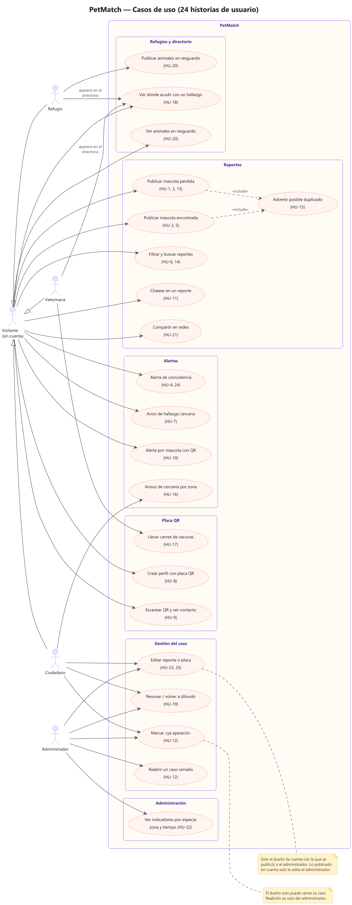

### 02 · Modelo de dominio
Entidades de `prisma/schema.prisma` y sus relaciones.

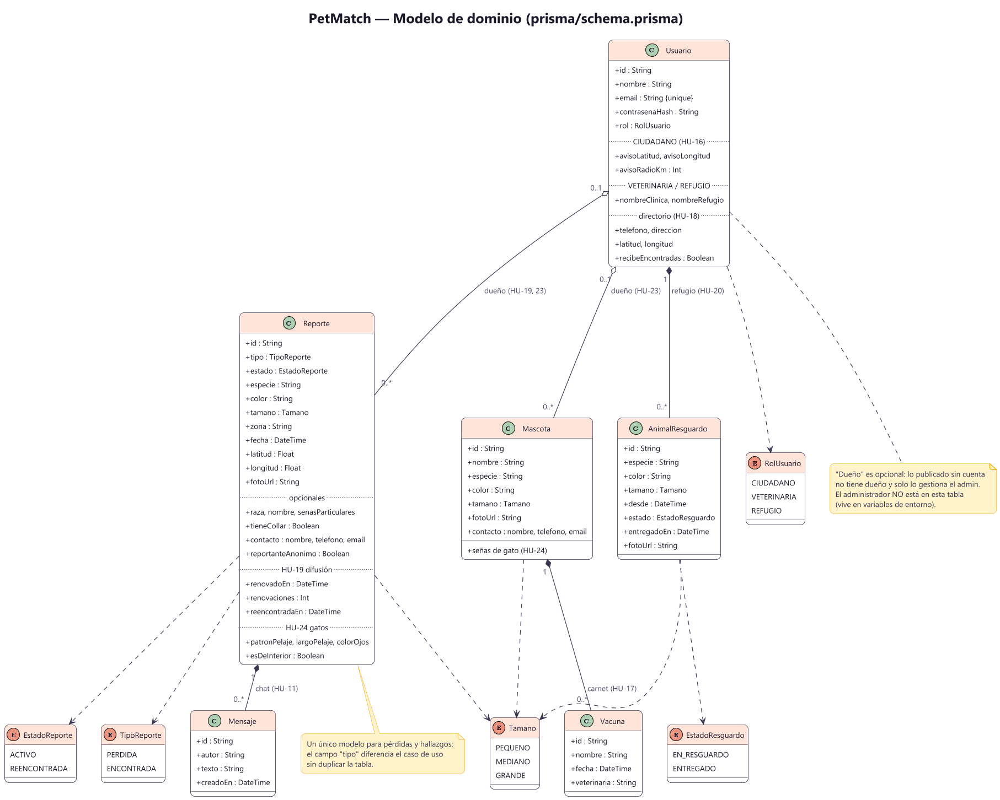

### 03 · Arquitectura por capas
Dirección de las dependencias: las flechas siempre apuntan hacia el dominio y
los puertos, nunca hacia Prisma ni el disco.

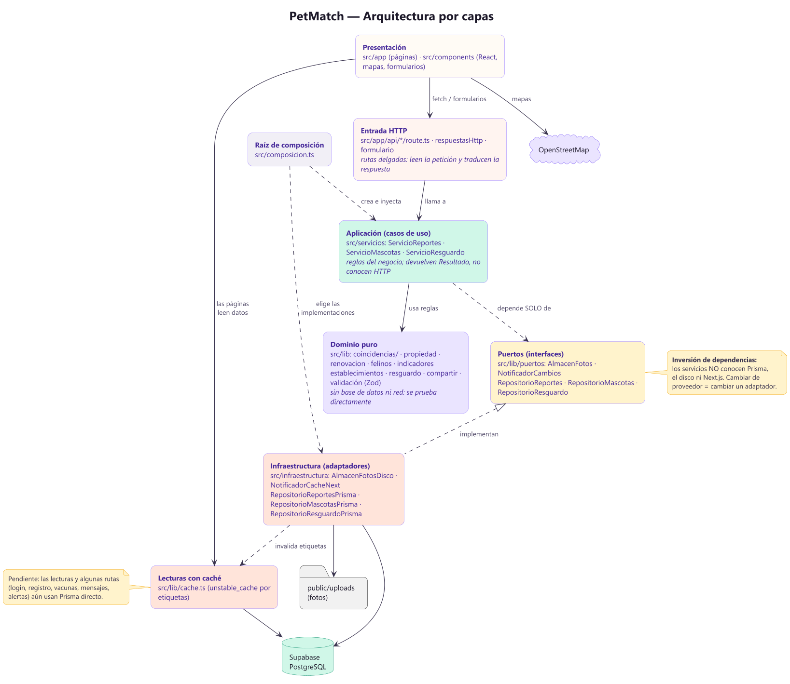

### 04 · SOLID · D (inversión de dependencias)
Servicios que dependen de interfaces (puertos), con adaptadores de producción y
dobles de prueba intercambiables.

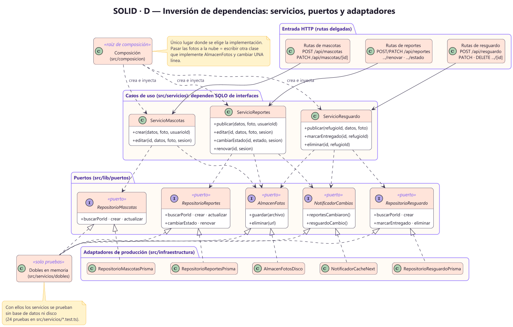

### 05 · SOLID · O (abierto/cerrado)
Motor de puntuación y criterios intercambiables (patrón Strategy).

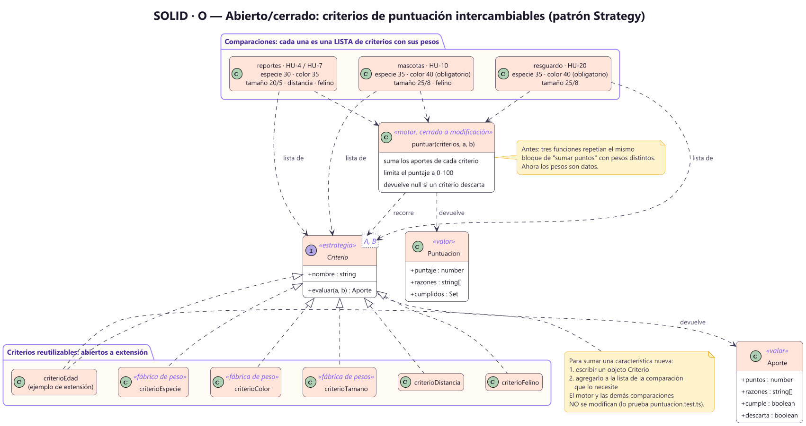

### 06 · SOLID · I y L
Interfaces pequeñas que se componen, y criterios que aceptan cualquier tipo que
cumpla su contrato.

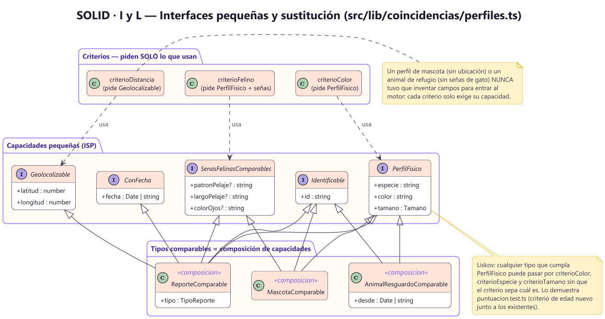

### 07 · SOLID · S (responsabilidad única)
Antes y después de dividir `coincidencias.ts` y las rutas de escritura.

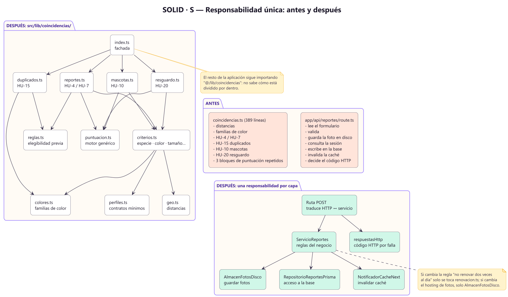

### 08 · Publicar un reporte
Paso a paso, de la persona a la base de datos, con los caminos de error.

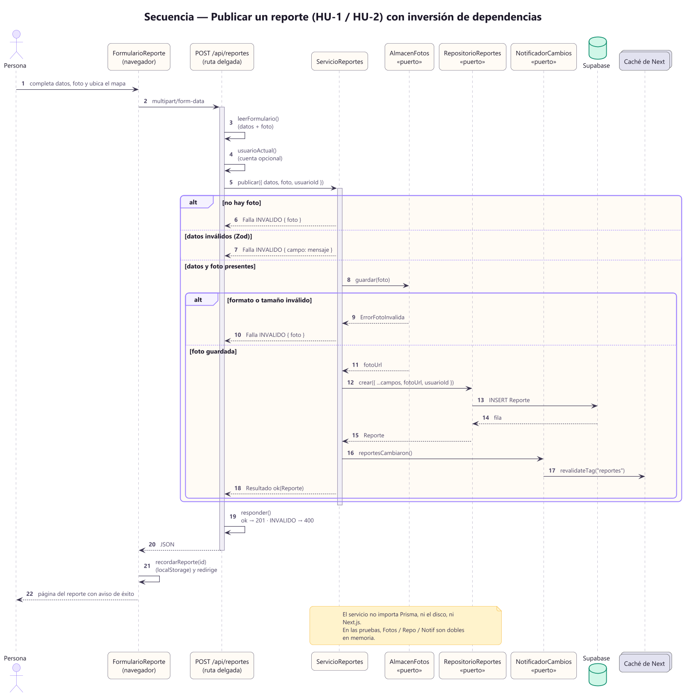

### 09 · Renovar y cerrar un caso
Permisos y respuestas (401, 403, 404, 409, 429) de HU-19 y HU-12.

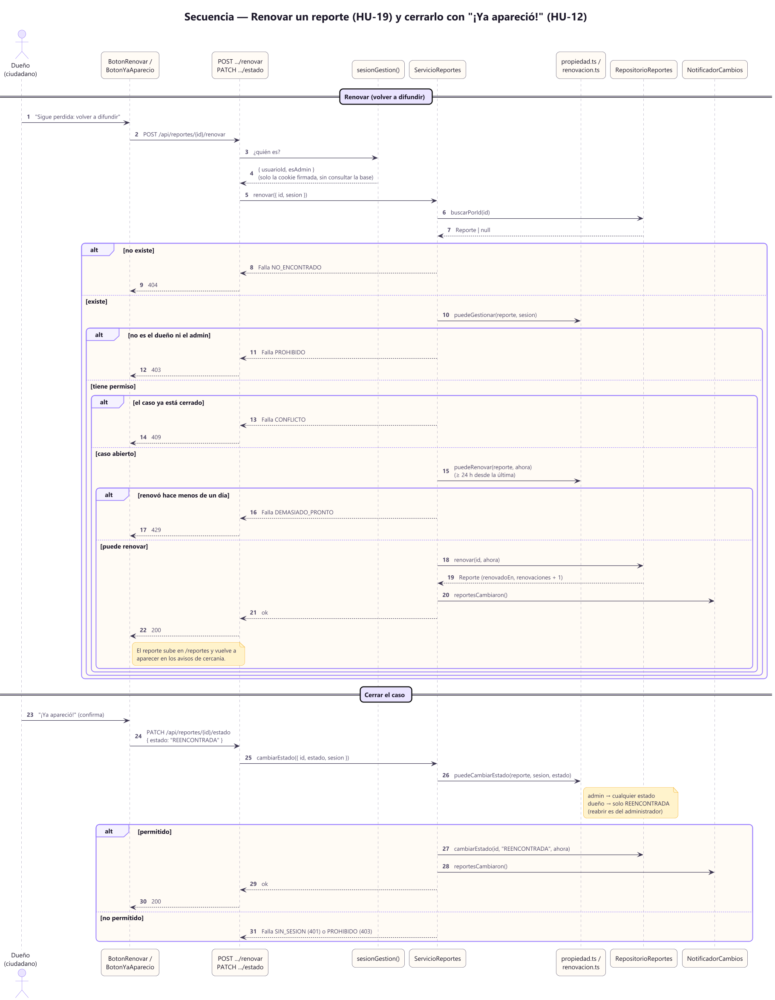

### 10 · Alertas de coincidencia
Cómo la campana calcula las alertas, con la caché y el motor de criterios.

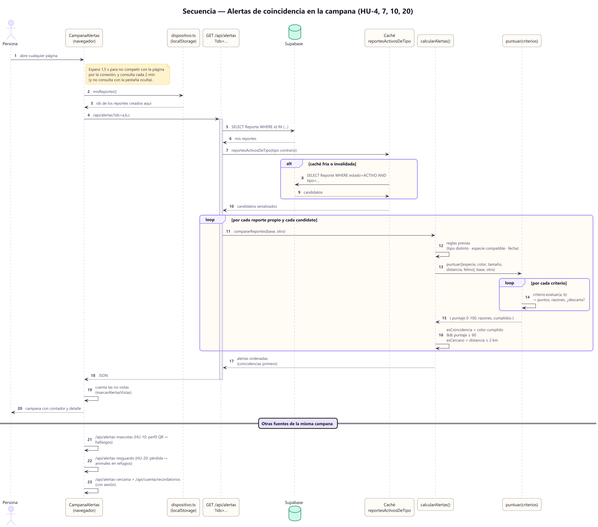

### 11 · Inicio de sesión
Cookie firmada, redirección por rol y por qué el navbar no consulta la base.

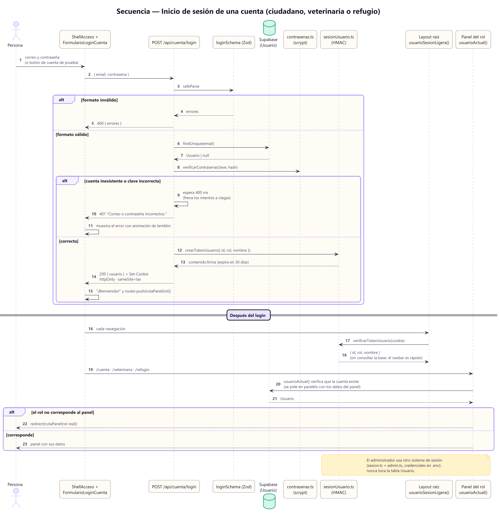

### 12 · Estados
Ciclo de vida del reporte (con renovación y cierre) y del animal en resguardo.

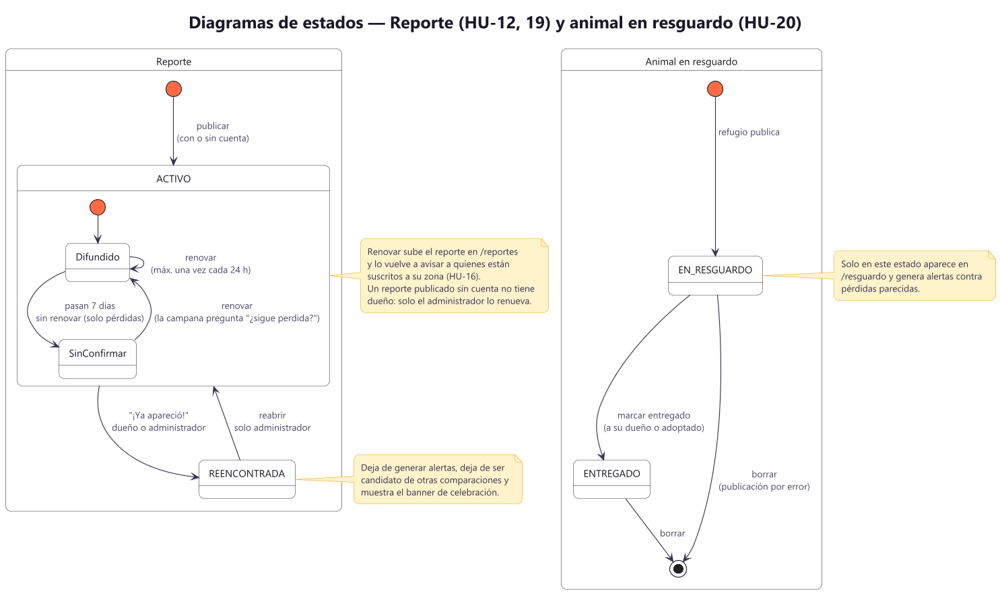

### 13 · Decisión de coincidencia
Flujo completo: reglas previas, criterios, descarte, umbral y orden.

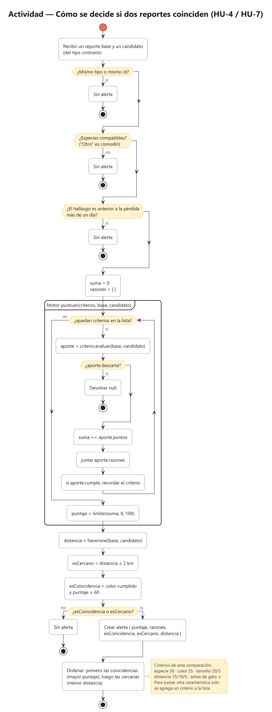

### 14 · Despliegue
Navegador, servidor Next.js, Supabase (con RLS) y el almacenamiento de fotos.

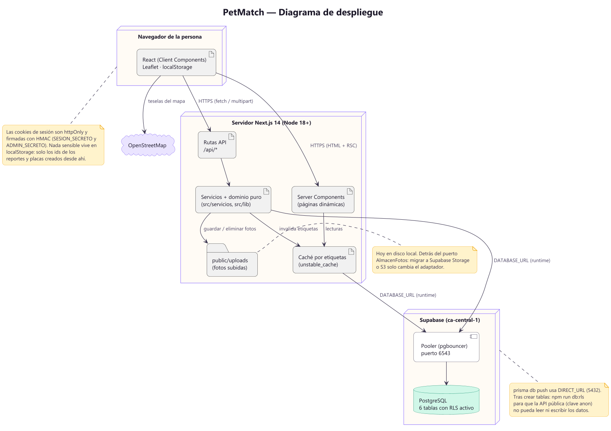
