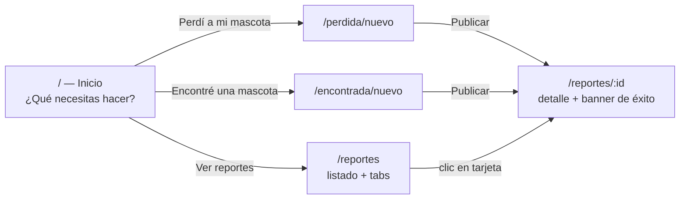

# Diseño de producto — Backend, Frontend, Base de datos, Interfaz y Roadmap de historias

> Este documento complementa a `docs/ARQUITECTURA.md` (que ya detalla el
> modelo de datos, RLS y Storage propuestos para Supabase). Aquí se
> consolida el diseño completo del sistema — backend, frontend, interfaz
> y la re-priorización de **todo** el Product Backlog en sprints — no solo
> el Sprint 1. Es un documento de **diseño/planeación**, no introduce
> ningún cambio en el código, la base de datos ni la infraestructura.

## 0. Stack tecnológico

| Capa | Tecnología | Por qué |
|---|---|---|
| Frontend + Backend | **Next.js 14** (App Router), TypeScript | Un solo proyecto full-stack: páginas y `/api/*` en el mismo proceso, ideal para el ritmo de un proyecto académico |
| Estilos | **Tailwind CSS** | Utilidades atómicas, consistencia visual rápida, buen soporte responsive |
| ORM / acceso a datos | **Prisma** | Tipado de extremo a extremo con TypeScript, migraciones versionadas, abstrae el motor de BD |
| Base de datos | **PostgreSQL administrado en Supabase** | Sin servidor propio que mantener; RLS, Storage y (a futuro) Auth nativos |
| Mapas | **React-Leaflet + OpenStreetMap** | Gratuito, sin API key, suficiente para seleccionar/mostrar un punto (HU-3) |
| Almacenamiento de fotos | **Supabase Storage** (bucket público `fotos-reportes`) | Evita guardar binarios en Postgres; URLs públicas servidas por Supabase |
| Validación | **Zod** | Un único esquema compartido entre formulario (cliente) y API (servidor) |
| Pruebas | **Vitest** | Rápido, ya integrado, cubre validación y almacenamiento |
| Cliente Supabase | **@supabase/supabase-js** (server-side, llave `anon`) | Solo para Storage por ahora; nunca la llave secreta |
| Autenticación (a partir del Sprint donde se necesite) | **Supabase Auth** | Ninguna historia de Sprint 1 la requiere; se introduce como habilitador cuando el backlog lo exija (ver sección 5) |

No se propone React Native / apps nativas todavía: el backlog completo (24 historias) se resuelve con una web responsive; "móvil" se cubre con diseño mobile-first, no con una app nativa separada. Si en algún sprint futuro se decide empaquetar como app (Capacitor, Expo, etc.), es una decisión a tomar en ese momento, no ahora.

## 1. Diseño de backend

El backend vive dentro del mismo proyecto Next.js, como **API Routes** (`src/app/api/**`). No hay un servicio separado.

### 1.1 Capas

```
Página / componente cliente
        │  fetch() / formData
        ▼
API Route (src/app/api/reportes/**)
        │
        ▼
Validación (Zod — src/lib/validacion.ts)   ← única fuente de verdad de "qué es un reporte válido"
        │
        ├──▶ Almacenamiento de fotos (src/lib/almacenamiento.ts) → Supabase Storage
        │
        ▼
Prisma Client (src/lib/db.ts) → PostgreSQL (Supabase)
```

### 1.2 Principios de diseño

- **Un único esquema de validación** (`reporteSchema`) usado tanto por el formulario (feedback inmediato) como por la API (autoridad real). Nunca se confía solo en lo que valida el navegador.
- **Los servicios de infraestructura están aislados detrás de una función**, no repartidos por las rutas: `almacenamiento.ts` para fotos, `db.ts` para la conexión a Prisma. Cambiar de proveedor de Storage o de motor de base de datos no debería tocar las rutas ni los componentes.
- **Sin lógica de negocio en los componentes de React** — las páginas y componentes solo arman el `FormData`/leen la respuesta; toda regla (qué es obligatorio, qué requiere contacto, qué tamaño de imagen se acepta) vive en `src/lib/`.
- **RLS como cinturón de seguridad, no como única barrera** (ver `docs/ARQUITECTURA.md` sección 6) — el backend Next.js sigue siendo el punto de validación principal.

### 1.3 Endpoints (Sprint 1, ya implementados)

| Método | Ruta | Función |
|---|---|---|
| `GET` | `/api/reportes` | Lista reportes, filtro opcional `?tipo=PERDIDA\|ENCONTRADA` |
| `POST` | `/api/reportes` | Crea un reporte (`multipart/form-data`: campos + foto) |
| `GET` | `/api/reportes/[id]` | Detalle de un reporte |

No existen (ni deben existir en Sprint 1) `PATCH`/`DELETE` — ninguna historia los requiere, y así la RLS de la sección H del informe anterior queda trivialmente correcta (nadie puede mutar ni borrar).

### 1.4 Qué cambia backend-wise al aprobar la fase de Supabase

- `almacenamiento.ts` deja de escribir en `public/uploads` y sube el archivo a Supabase Storage vía `@supabase/supabase-js`, devolviendo la **ruta** dentro del bucket (no la URL completa).
- `db.ts` sigue igual (Prisma), solo cambia el destino de `DATABASE_URL`/`DIRECT_URL`.
- Se agregan migraciones versionadas (`prisma/migrations/`) en vez de `db push`.

## 2. Diseño de frontend

### 2.1 Arquitectura de componentes (ya implementada)

```
src/app/
├─ page.tsx                     Pantalla inicial ("¿Qué necesitas hacer?")
├─ perdida/nuevo/page.tsx       → <FormularioReporte tipo="PERDIDA" />
├─ encontrada/nuevo/page.tsx    → <FormularioReporte tipo="ENCONTRADA" />
├─ reportes/page.tsx            Listado (server component, consulta Prisma directo)
└─ reportes/[id]/page.tsx       Detalle (server component) → <DetalleReporte />

src/components/
├─ FormularioReporte.tsx        Formulario compartido (2 pasos: datos → confirmación)
├─ MapaSelector.tsx             Cliente, Leaflet interactivo (clic / geolocalización)
├─ MapaVisor.tsx                Cliente, Leaflet de solo lectura
├─ CampoImagen.tsx              Input de foto con previsualización
├─ TarjetaReporte.tsx           Tarjeta del listado
└─ DetalleReporte.tsx           Vista de detalle completa
```

### 2.2 Decisiones de diseño frontend

- **Un componente de formulario, no dos**: `FormularioReporte` recibe `tipo` como prop y ajusta textos/campos (p. ej. "Nombre de la mascota" solo aplica a `PERDIDA`). Evita divergencia entre los dos flujos de HU-13.
- **Server Components por defecto**: listado y detalle consultan Prisma directamente en el servidor (sin round-trip extra a la API). Solo los componentes que necesitan interactividad (formulario, mapa, imagen) son `"use client"`.
- **Leaflet siempre con `next/dynamic(ssr:false)`**: Leaflet depende de `window`, así que nunca se renderiza en el servidor.
- **Un solo esquema de colores por tipo de reporte**: ámbar (`perdida-*`) y verde (`encontrada-*`) definidos en `tailwind.config.ts`, usados de forma consistente en botones, badges y pines del mapa — refuerza visualmente "estoy en el flujo de X" en toda la app.
- **Manejo de estado simple con `useState`**: no hay necesidad de una librería de estado global (Redux/Zustand) para el alcance actual; se reevaluará si Sprint 2+ introduce datos compartidos entre muchas pantallas (p. ej. sesión de usuario tras Auth).

### 2.3 Qué se prepara (sin construir) para sprints futuros

- La estructura por carpetas de ruta (`app/<seccion>/...`) ya admite agregar `app/reportes/[id]/editar/` o `app/cuenta/` sin reorganizar nada existente.
- El header (`layout.tsx`) tiene un solo link ("Ver reportes"); cuando exista Auth, ahí se agrega el estado de sesión (avatar/"Iniciar sesión") sin rediseñar el layout.

## 3. Diseño de base de datos

El detalle completo (tabla `reportes`, tipos de columna, constraints, índices, RLS, bucket de Storage) ya está desarrollado en **`docs/ARQUITECTURA.md`** y en el informe de la fase de análisis Supabase — no se repite aquí para no duplicar contenido que puede desincronizarse. Resumen ejecutivo:

- Una sola tabla `reportes`, sin tabla de usuarios (ninguna historia de Sprint 1 la requiere).
- Enums nativos de Postgres para `tipo`, `tamano`, `estado`.
- `latitud`/`longitud` como `double precision` (no PostGIS todavía — no hay historias de proximidad en Sprint 1).
- Fotos en Supabase Storage (bucket `fotos-reportes`), la tabla solo guarda la ruta.
- RLS habilitado: lectura e inserción pública, sin `UPDATE`/`DELETE` para nadie (coherente con que ninguna historia de Sprint 1 edita o borra reportes).

La sección 5 de este documento (roadmap) indica qué agrega cada sprint futuro a este modelo (nuevas tablas, nuevos campos, cuándo aparece Auth).

## 4. Diseño de interfaz (UX/UI)

### 4.1 Mapa de pantallas (Sprint 1, implementado)



### 4.2 Principios visuales

- **Español en toda la interfaz**, tono cercano pero profesional (no infantil, no corporativo-frío) — coherente con ser una herramienta usada en un momento de estrés (mascota perdida).
- **Color como código de estado**: ámbar = búsqueda en curso, verde = hallazgo — el usuario reconoce el tipo de reporte sin leer el badge.
- **Mobile-first**: formularios en una sola columna, mapa a ancho completo, botones grandes (objetivo táctil ≥ 44px) — la mayoría de reportes se crean desde la calle, con el celular.
- **Confirmación antes de publicar** en ambos flujos: nunca se envía nada a la API sin que la persona vea un resumen y decida "Publicar" explícitamente.
- **Errores en el lugar donde ocurren**: mensaje debajo del campo específico, no solo un banner genérico arriba.

### 4.3 Qué falta de interfaz para completar el backlog (no construido, documentado para más adelante)

- Pantalla de filtros (HU-6): barra de filtros sobre el listado actual, mismo layout de tarjetas.
- Badge "Reencontrada" (HU-12) sobre `TarjetaReporte` cuando el estado lo permita.
- Pantalla de perfil de mascota + QR (HU-8/9): nueva sección `/mascotas/`, fuera del flujo de reportes.
- Sesión/cuenta (header): solo aparece cuando el backlog lo requiera (sección 5).

## 5. Historias de usuario (backlog vigente)

El backlog se redujo a 8 historias. HU-7 cambió: la comparación automática
de fotos se reemplazó por una notificación de hallazgos cercanos al lugar de
la pérdida.

| HU | Historia | Valor | Urgencia | Prioridad | Complejidad | Estado |
|---|---|---|---|---|---|---|
| HU-1 | **Como** dueño de mascota **quiero** registrar un único reporte de mi mascota perdida con foto, fecha, zona y señas particulares **para** no tener que repetir la misma publicación en varios grupos y redes | 9 | 8 | 72 | 5 | ✅ Implementada |
| HU-2 | **Como** hallador **quiero** registrar un hallazgo en menos de un minuto y sin crear una cuenta **para** que la falta de tiempo o de registro no me impida reportar | 9 | 8 | 72 | 4 | ✅ Implementada |
| HU-3 | **Como** dueño de mascota **quiero** ubicar en un mapa el punto y la fecha donde se vio por última vez a mi mascota **para** concentrar la búsqueda en la zona correcta | 9 | 8 | 72 | 6 | ✅ Implementada |
| HU-4 | **Como** dueño de mascota **quiero** recibir una alerta apenas se publique un reporte que coincida con las características de mi mascota **para** actuar en las primeras horas de la pérdida | 9 | 8 | 72 | 8 | ✅ Implementada |
| HU-5 | **Como** hallador **quiero** reportar una mascota encontrada en el mismo lugar donde se publican las pérdidas **para** que mi hallazgo llegue directamente a quien la está buscando | 8 | 8 | 64 | 5 | ✅ Implementada |
| HU-6 | **Como** dueño de mascota **quiero** filtrar los reportes por zona, especie, color, tamaño y rango de fechas **para** revisar solo lo que puede corresponder a mi caso | 8 | 7 | 56 | 4 | ✅ Implementada |
| HU-7 | **Como** dueño de mascota **quiero** que el sistema me notifique cuando existe un encuentro cerca o en el lugar donde se perdió mi mascota | — | — | *por definir* | *por definir* | ✅ Implementada |
| HU-8 | **Como** dueño de mascota **quiero** crear un perfil digital de mi mascota con un código QR imprimible **para** que quien la encuentre pueda contactarme aunque no tenga microchip | 8 | 6 | 48 | 6 | ✅ Implementada |

**Mejoras adicionales ya implementadas** (no son historias del backlog
vigente): editar reportes y marcarlos como "reencontrada" desde un acceso de
administrador, y la fecha **y hora** de cada pérdida o hallazgo junto con la
fecha y hora de publicación.

### 5.1 Cómo se implementaron HU-4 y HU-7 (sin cuentas de usuario)

- **Coincidencias (HU-4):** `src/lib/coincidencias.ts` compara un reporte con
  los del tipo contrario. Exige la misma especie, fechas compatibles (un
  hallazgo no puede ser muy anterior a la pérdida) y un color en común; suma
  puntos por tamaño y cercanía. Los colores escritos libremente se agrupan
  en familias ("café", "marrón" y "chocolate" cuentan como el mismo color).
- **Hallazgos cercanos (HU-7):** cualquier hallazgo a menos de 2 km del
  lugar de la pérdida (distancia real con la fórmula del haversine) genera
  una alerta, aunque no se parezca, y se muestra en un mapa con el radio.
- **Notificación:** como no hay cuentas, el navegador recuerda los reportes
  publicados desde él (`localStorage`). La campana del navbar consulta
  `GET /api/alertas` cada minuto y muestra cuántas alertas son nuevas. El
  detalle de cada reporte también muestra sus coincidencias y hallazgos
  cercanos a cualquier visitante.

### 5.2 Cómo se implementó HU-8

Entidad nueva `Mascota`, independiente de los reportes. El dueño crea el
perfil en `/mascotas/nueva` (sin cuenta) y recibe una placa imprimible en
`/mascotas/[id]/placa` con un QR que abre el perfil público
`/mascotas/[id]`. Ese perfil tiene botones para llamar o escribir por
WhatsApp. Para que el QR funcione desde otros celulares, la variable
`URL_PUBLICA` debe apuntar al dominio donde se publique la aplicación.

### 5.3 Mapa

Todos los mapas para marcar ubicación arrancan centrados en **Pasto
(Nariño)**.
